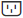
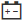

= Affichez l'état et les paramètres des composants de l'étagère dans SANtricity System Manager
:allow-uri-read: 
:experimental: 
:icons: font
:imagesdir: ../media/

[role="lead"]
La page Matériel fournit l'état et les paramètres des composants de l'étagère, notamment les alimentations, les ventilateurs et les batteries.

.À propos de cette tâche
Les composants disponibles dépendent du type d'étagère :

* *Étagère de disques* -- Contient un ensemble de disques, de boîtiers d'alimentation/ventilateurs, de modules d'entrée/sortie (IOM) et d'autres composants de support dans une seule étagère.
* *Étagère de contrôleur* -- Contient un ensemble de disques, un ou deux boîtiers de contrôleur, des boîtiers d'alimentation/ventilateur et d'autres composants de support dans une seule étagère.

.Étapes
. Sélectionnez *Hardware*.
. Sélectionnez la liste déroulante pour le Controller Shelf ou le Drive Shelf, puis sélectionnez *Afficher les paramètres*.
+
La boîte de dialogue Paramètres des composants d'étagère s'ouvre, avec des onglets affichant l'état et les paramètres relatifs aux composants d'étagère. Selon le type d'étagère sélectionné, certains onglets décrits dans le tableau peuvent ne pas apparaître.

+
[cols="25h,~"]
|===
| Onglet | Description 

 a| 
Tiroir
 a| 
L’onglet *Shelf* affiche les propriétés suivantes :

** *Shelf ID* -- identifie de manière unique une étagère dans la baie de stockage. Le micrologiciel du contrôleur attribue ce numéro, mais vous pouvez le modifier en sélectionnant menu:Shelf[Change ID].
** *Redondance du chemin d'accès de l'étagère* -- Spécifie si les connexions entre l'étagère et le contrôleur disposent de méthodes alternatives (Oui) ou non (Non).
** *Types de disques actuels* -- Indique le type de technologie intégrée aux disques (par exemple, un disque SAS qui est compatible avec la sécurité). S'il existe plus d'un type de disque, les deux technologies sont affichées.
** *Numéro de série* -- Affiche le numéro de série de l'étagère.

 a| 
IOM (ESM)
 a| 
L'onglet *IOMs (ESMs)* affiche l'état du module d'entrée/sortie (IOM), également appelé module de service environnemental (ESM). Il surveille l'état des composants d'une baie de disques et sert de point de connexion entre le tiroir de disques et le contrôleur.

L'état peut être Optimal, Failed, Optimal (Miswire) ou Uncertified. D'autres informations incluent la version du firmware et la version des paramètres de configuration.

Sélectionnez *Afficher plus de paramètres* pour voir les débits de données maximum et actuels, ainsi que l'état de la communication de la carte (soit Oui ou Non).

[NOTE]
====
Vous pouvez également consulter cet état en sélectionnant l’icône IOM image:../media/sam1130-ss-hardware-iom-icon.gif[""], à côté de la liste déroulante Shelf.

====

 a| 
Alimentations électriques
 a| 
L'onglet *Alimentations* affiche l'état du boîtier d'alimentation et de l'alimentation elle-même. L'état peut être Optimal, Failed, Removed ou Unknown. Il indique également le numéro de pièce de l'alimentation.

[NOTE]
====
Vous pouvez également consulter cet état en sélectionnant l’icône Alimentation , à côté de la liste déroulante Étagère.

====

 a| 
Ventilateurs
 a| 
L'onglet *Ventilateurs* affiche l'état du boîtier du ventilateur et du ventilateur lui-même. L'état peut être Optimal, Failed, Removed ou Unknown.

[NOTE]
====
Vous pouvez également consulter cet état en sélectionnant l'icône Ventilateur , à côté de la liste déroulante Étagère.

====

 a| 
Température
 a| 
L'onglet *Température* affiche l'état de la température des composants de l'étagère, tels que les capteurs, les contrôleurs et les modules d'alimentation/ventilateurs. L'état peut être Optimal, Température nominale dépassée, Température maximale dépassée ou Inconnu.

[NOTE]
====
Vous pouvez également consulter cet état en sélectionnant l’icône Température , à côté de la liste déroulante Étagère.

====

 a| 
Batteries
 a| 
L'onglet *Batteries* affiche l'état des batteries du contrôleur. L'état peut être Optimal, Failed, Removed ou Unknown. D'autres informations incluent l'âge de la batterie, le nombre de jours avant le remplacement, les cycles d'apprentissage et les semaines entre les cycles d'apprentissage.

[NOTE]
====
Vous pouvez également consulter cet état en sélectionnant l’icône Batteries , située à côté de la liste déroulante Étagère.

====

 a| 
SFP
 a| 
L'onglet *SFPs* affiche l'état des émetteurs-récepteurs Small Form-factor Pluggable (SFP) sur les contrôleurs. L'état peut être Optimal, Failed ou Unknown.

Sélectionnez *Afficher plus de paramètres* pour voir le numéro de pièce, le numéro de série et le fournisseur des SFP.

[NOTE]
====
Vous pouvez également consulter cet état en sélectionnant l’icône SFP , à côté de la liste déroulante Shelf.

====
|===
. Cliquez sur *Close*.

