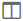
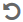

= Afficher l'activité du journal des audits dans SANtricity System Manager
:allow-uri-read: 
:experimental: 
:icons: font
:imagesdir: ../media/

[role="lead"]
En consultant les journaux des audits, les utilisateurs disposant des autorisations Security Admin peuvent surveiller les actions des utilisateurs, les échecs d'authentification, les tentatives de connexion invalides et la durée de vie des sessions utilisateur.

.Avant de commencer
Vous devez être connecté avec un profil utilisateur disposant des autorisations d'administrateur de sécurité. Sinon, les fonctions de gestion des accès ne s'affichent pas.

.Étapes
. Sélectionnez le menu : Settings [Gestion des accès].
. Sélectionnez l’onglet **journal des audits**.
+
L'activité du journal des audits apparaît sous forme de tableau, qui comprend les colonnes d'informations suivantes :

+
** *Date/Heure* -- Horodatage du moment où la baie de stockage a détecté l'événement (en GMT).
** *Nom d'utilisateur* -- Le nom d'utilisateur associé à l'événement. Pour toute action non authentifiée sur la baie de stockage, « N/A » apparaît comme nom d'utilisateur. Les actions non authentifiées peuvent être déclenchées par le proxy interne ou un autre mécanisme.
** *Code d'état* -- Code d'état HTTP de l'opération (200, 400, etc.) et texte descriptif associé à l'événement.
** *URL consultée* -- URL complète (y compris host) et chaîne de requête.
** *Adresse IP du client* -- Adresse IP du client associée à l'événement.
** *Source* -- Source de journalisation associée à l’événement, qui peut être System Manager, CLI, Web Services ou Support Shell.
** *Description* -- Informations supplémentaires sur l'événement, le cas échéant.

. Utilisez les sélections de la page journal des audits pour consulter et gérer les événements.
+
.Détails de la sélection
[%collapsible]
====
[cols="25h,~"]
|===
| Sélection | Description 

 a| 
Afficher les événements de...
 a| 
Limiter les événements affichés par plage de dates (24 dernières heures, 7 derniers jours, 30 derniers jours ou une plage de dates personnalisée).

 a| 
Filtre
 a| 
Limitez les événements affichés aux caractères saisis dans le champ. Utilisez des guillemets (« ») pour une correspondance exacte de mot, saisissez  `OR` pour afficher un ou plusieurs mots, ou saisissez un tiret ( -- ) pour omettre des mots.

 a| 
Rafraîchir
 a| 
Sélectionnez *Actualiser* pour mettre à jour la page vers les événements les plus récents.

 a| 
Afficher/Modifier les paramètres
 a| 
Sélectionnez *Afficher/Modifier les paramètres* pour ouvrir une boîte de dialogue qui vous permet de spécifier une politique de journalisation complète et le niveau des actions à enregistrer.

 a| 
Supprimer les événements
 a| 
Sélectionnez *Delete* pour ouvrir une boîte de dialogue qui vous permet de supprimer les anciens événements de la page.

 a| 
Afficher/masquer les colonnes
 a| 
Cliquez sur l’icône de colonne *Afficher/Masquer*  pour sélectionner des colonnes supplémentaires à afficher dans le tableau. Les colonnes supplémentaires incluent :

** *Méthode* -- La méthode HTTP (par exemple, POST, GET, DELETE, etc.).
** *Commande CLI exécutée* -- La commande CLI (grammaire) exécutée pour les requêtes Secure CLI.
** *État de retour CLI* -- Un code d'état CLI ou une demande de fichiers d'entrée du client.
** *Procédure SYMbol* -- La procédure SYMbol a été exécutée.
** *Type d'événement SSH* -- Type d'événements Secure Shell (SSH), tels que login, logout et login_fail.
** *PID de session SSH* -- Numéro d'identification du processus de la session SSH.
** *Durée(s) de la session SSH* -- Le nombre de secondes pendant lesquelles l'utilisateur était connecté.
** *Type d'authentification* -- Les types peuvent inclure l'utilisateur local, LDAP, SAML et Access token.
** *Authentication ID* -- ID de la session authentifiée.

 a| 
Activer/désactiver les filtres de colonne
 a| 
Cliquez sur l'icône *Basculer* image:../media/sam-1140-ss-access-toggle.gif["Basculer"] pour ouvrir les champs de filtrage pour chaque colonne. Saisissez des caractères dans un champ de colonne pour limiter les événements affichés par ces caractères. Cliquez à nouveau sur l'icône pour fermer les champs de filtrage.

 a| 
Annuler les modifications
 a| 
Cliquez sur l'icône *Annuler*  pour rétablir la configuration par défaut du tableau.

 a| 
Exporter
 a| 
Cliquez sur *Exporter* pour enregistrer les données du tableau dans un fichier CSV (comma separated value).

|===
====

