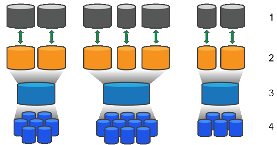

= Fonctionnement des pools et des groupes de volumes dans le logiciel SANtricity
:allow-uri-read: 
:icons: font
:imagesdir: ../media/

[role="lead"]
Pour provisionner le stockage, vous créez soit un pool, soit un groupe de volumes qui contiendra les Hard Disk Drives (HDD) ou Solid State Disk (SSD) drives que vous souhaitez utiliser dans votre baie de stockage.

Le matériel physique est organisé en composants logiques afin que les données puissent être structurées et facilement récupérées. Deux types de regroupements sont pris en charge :

* Pools
* groupes de volumes RAID

Les pools et les groupes de volumes constituent les unités de stockage de niveau supérieur d'une baie de stockage : ils divisent la capacité des disques en divisions gérables. Au sein de ces divisions logiques se trouvent les volumes individuels ou LUN, où les données sont stockées. La figure suivante illustre ce concept.

^1^ LUN hôtes ; ^2^ Volumes ; ^3^ Groupes ou pools de volumes ; ^4^ HDD ou SSD drives

Lors du déploiement d'un système de stockage, la première étape consiste à présenter la capacité de disque disponible aux différents hôtes en :

* Création de pools ou de groupes de volumes avec une capacité suffisante
* Ajout du nombre de disques nécessaires pour répondre aux exigences de performance au pool ou au groupe de volumes
* Sélection du niveau de protection RAID souhaité (si vous utilisez des groupes de volumes) pour répondre à des exigences métier spécifiques

Vous pouvez avoir des pools ou des groupes de volumes sur le même système de stockage, mais un disque ne peut faire partie que d'un seul pool ou groupe de volumes. Les volumes qui sont présentés aux hôtes pour les E/S sont ensuite créés en utilisant l'espace sur le pool ou le groupe de volumes.

== Pools

Les pools sont conçus pour regrouper des disques durs physiques en un grand espace de stockage et pour offrir une protection RAID améliorée. Un pool crée de nombreux ensembles RAID virtuels à partir du nombre total de disques attribués au pool et répartit les données de manière uniforme entre tous les disques participants. Si un disque est perdu ou ajouté, System Manager rééquilibre dynamiquement les données sur tous les disques actifs.

Les pools fonctionnent comme un autre niveau RAID, virtualisant l'architecture RAID sous-jacente afin d'optimiser les performances et la flexibilité lors de tâches telles que la reconstruction, l'expansion de disque et la gestion de la perte de disque. System Manager définit automatiquement le niveau RAID à 6 dans une configuration 8+2 (huit disques de données plus deux disques de parité).

=== Correspondance des disques

Vous pouvez choisir entre des HDD ou des SSD pour une utilisation dans les pools ; cependant, comme pour les groupes de volumes, tous les disques du pool doivent utiliser la même technologie. Les contrôleurs sélectionnent automatiquement les disques à inclure, vous devez donc vous assurer de disposer d'un nombre suffisant de disques pour la technologie que vous choisissez.

=== Gestion des disques défaillants

Les pools ont une capacité minimale de 11 disques ; cependant, la capacité d'un disque est réservée comme capacité de secours en cas de panne disque. Cette capacité de secours est appelée « capacité de préservation ».

Lors de la création de pools, une certaine capacité est réservée pour les situations d'urgence. Cette capacité est exprimée en nombre de disques dans System Manager, mais la mise en œuvre réelle est répartie sur l'ensemble du pool de disques. La quantité par défaut de capacité qui est réservée dépend du nombre de disques dans le pool.

Après la création du pool, vous pouvez modifier la valeur de la capacité de préservation pour plus ou moins de capacité, ou même la définir à aucune capacité de préservation (l'équivalent de 0 disque). La quantité maximale de capacité pouvant être préservée (exprimée en nombre de disques) est de 10, mais la capacité disponible peut être inférieure, en fonction du nombre total de disques dans le pool.

== Groupes de volumes

Les groupes de volumes définissent la répartition de la capacité dans le système de stockage entre les volumes. Les disques durs sont organisés en groupes RAID et les volumes résident sur les disques d'un groupe RAID. Par conséquent, les paramètres de configuration du groupe de volumes identifient les disques qui font partie du groupe et le niveau RAID utilisé.

Lors de la création d'un groupe de volumes, les contrôleurs sélectionnent automatiquement les disques à inclure dans le groupe. Vous devez choisir manuellement le niveau RAID du groupe. La capacité du groupe de volumes correspond au nombre total de disques que vous sélectionnez, multiplié par leur capacité.

=== Correspondance des disques

Vous devez faire correspondre les disques du groupe de volumes en termes de taille et de performances. S'il y a des disques plus petits et plus grands dans le groupe de volumes, tous les disques sont reconnus comme ayant la plus petite capacité. S'il y a des disques plus lents et plus rapides dans le groupe de volumes, tous les disques sont reconnus à la vitesse la plus lente. Ces facteurs affectent les performances et la capacité globale du système de stockage.

Il est impossible de mélanger des technologies de disques différentes (HDD et SSD). RAID 3, 5 et 6 sont limités à un maximum de 30 disques. RAID 1 et RAID 10 utilisent la mise en miroir, donc ces groupes de volumes doivent comporter un nombre pair de disques.

=== Gestion des disques défaillants

Les groupes de volumes utilisent des disques de secours à chaud comme solution de repli en cas de panne disque dans les volumes RAID 1/10, RAID 3, RAID 5 ou RAID 6 contenus dans un groupe de volumes. Un disque de secours à chaud ne contient aucune donnée et ajoute un niveau de redondance supplémentaire à votre baie de stockage.

En cas de défaillance d'un disque dans la baie de stockage, le disque de secours à chaud est automatiquement substitué au disque défaillant sans nécessiter d'échange physique. Si le disque de secours à chaud est disponible lors de la défaillance d'un disque, le contrôleur utilise les données de redondance pour reconstruire les données du disque défaillant vers le disque de secours à chaud.
