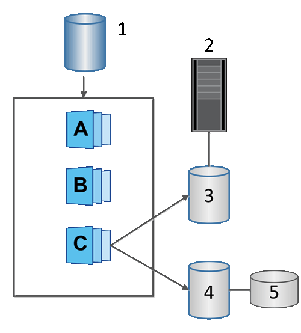

= Découvrez les volumes instantanés dans le logiciel SANtricity
:allow-uri-read: 
:icons: font
:imagesdir: ../media/

[role="lead"]
Vous pouvez créer un volume de snapshot et l'affecter à un hôte si vous souhaitez lire ou écrire des données de snapshot. Le volume de snapshot partage les mêmes caractéristiques que le volume de base (niveau RAID, caractéristiques d'E/S, etc.).

Lorsque vous créez un volume instantané, vous pouvez le désigner comme __lecture seule__ ou _accessible en lecture-écriture_.

Lors de la création de volumes snapshot en lecture seule, il n'est pas nécessaire d'ajouter de capacité réservée. Lors de la création de volumes snapshot en lecture-écriture, vous devez ajouter une capacité réservée pour permettre l'accès en écriture.

^1^ Volume de base; ^2^ Hôte; ^3^ Volume de snapshot en lecture seule; ^4^ Volume de snapshot en lecture-écriture; ^5^ Capacité réservée
