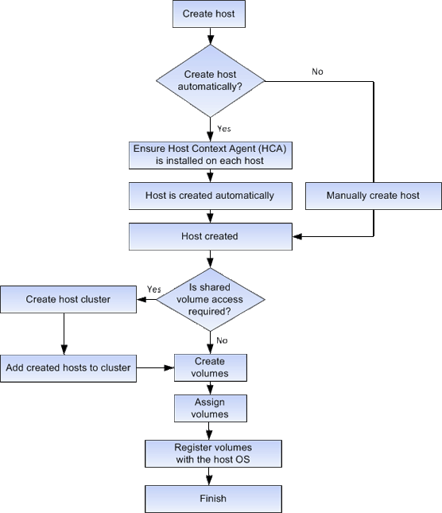

= Fonctionnement de la création d'hôtes et de l'attribution de volumes dans SANtricity System Manager
:allow-uri-read: 
:icons: font
:imagesdir: ../media/

[role="lead"]
La figure suivante illustre comment configurer l'accès à l'hôte.

