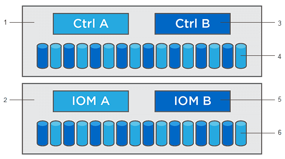

= Découvrez comment mettre à niveau le logiciel SANtricity
:allow-uri-read: 
:experimental: 
:icons: font
:imagesdir: ../media/

[role="lead"]
Utilisez le Centre de mise à niveau pour télécharger les derniers logiciels et firmware et pour mettre à niveau vos contrôleurs et disques.

[[controller-upgrade-overview]]
== Aperçu de la mise à niveau du contrôleur

Vous pouvez mettre à niveau le logiciel et le firmware de votre baie de stockage pour bénéficier de toutes les dernières fonctionnalités et corrections de bugs.

[[components-included-in-the-os-controller-upgrade]]
=== Composants inclus dans la mise à niveau du contrôleur du système d'exploitation

Plusieurs composants des baies de stockage contiennent des logiciels ou du matériel que vous pourriez souhaiter mettre à niveau occasionnellement.

* *Logiciel de gestion* -- System Manager est le logiciel qui gère la baie de stockage.
* *Micrologiciel du contrôleur* -- Le micrologiciel du contrôleur gère les E/S entre les hôtes et les volumes.
* *Controller NVSRAM* -- Le Controller NVSRAM est un fichier de contrôleur qui spécifie les paramètres par défaut des contrôleurs.
* *Firmware IOM* -- Le firmware du module d'E/S (IOM) gère la connexion entre un contrôleur et un châssis de disques. Il surveille également l'état des composants.
* *Logiciel de supervision* -- Le logiciel de supervision est la machine virtuelle sur un contrôleur dans laquelle le logiciel s'exécute.

^1^ Baie de contrôleur ; ^2^ Baie de disque ; ^3^ Logiciel, firmware du contrôleur, NVSRAM du contrôleur, logiciel de supervision ; ^4^ firmware ; ^5^ firmware de l'IOM ; ^6^ firmware

Vous pouvez consulter vos versions logicielles et firmware actuelles dans la boîte de dialogue Software and Firmware Inventory. Accédez au menu : Support [Upgrade Center], puis cliquez sur le lien *Software and Firmware Inventory*.

Dans le cadre du processus de mise à niveau, il peut être nécessaire de mettre à niveau le pilote multipath/basculement et/ou le pilote HBA de l'hôte afin que celui-ci puisse interagir correctement avec les contrôleurs. Pour déterminer si tel est le cas, consultez la https://imt.netapp.com/matrix/#welcome["NetApp Interoperability Matrix Tool"^].

[[when-to-stop-io]]
=== Quand arrêter les E/S

Si votre baie de stockage comporte deux contrôleurs et qu'un pilote multipath est installé, la baie de stockage peut continuer à traiter les E/S pendant la mise à niveau. Pendant la mise à niveau, le contrôleur A bascule tous ses volumes vers le contrôleur B, effectue la mise à niveau, récupère ses volumes ainsi que tous les volumes du contrôleur B, puis met à niveau le contrôleur B.

[[pre-upgrade-health-check]]
=== Vérification de l'état avant la mise à niveau

Une vérification de l'état préalable à la mise à niveau est exécutée dans le cadre du processus de mise à niveau. La vérification de l'état préalable à la mise à niveau évalue tous les composants de la baie de stockage afin de garantir que la mise à niveau peut se dérouler. Les conditions suivantes peuvent empêcher la mise à niveau :

* Lecteurs attribués défaillants
* Disques de secours en service
* Groupes de volumes incomplets
* Opérations exclusives en cours
* Volumes manquants
* Contrôleur en état non optimal
* Nombre excessif d'événements du journal des événements
* Échec de la validation de la base de données de configuration
* Lecteurs avec d'anciennes versions de DACstore

Vous pouvez également exécuter la vérification de l'état séparément, sans effectuer de mise à niveau.

[[drive-upgrade-overview]]
== Aperçu de la mise à niveau du disque

Le firmware contrôle les caractéristiques de fonctionnement de bas niveau d'un disque. Périodiquement, les fabricants de disques publient des mises à jour du firmware pour ajouter de nouvelles fonctionnalités, améliorer les performances et corriger des défauts.

[[online-and-offline-drive-firmware-upgrades]]
=== Mises à niveau du firmware des disques en ligne et hors ligne

Il existe deux types de méthodes de mise à niveau du firmware des disques : en ligne et hors ligne.

==== En ligne

Lors d'une mise à niveau en ligne, les disques sont mis à niveau séquentiellement, un à la fois. La baie de stockage continue de traiter les E/S pendant la mise à niveau. Vous n'avez pas à arrêter les E/S. Si un disque peut effectuer une mise à niveau en ligne, la méthode en ligne est utilisée automatiquement.

Les disques permettant une mise à niveau en ligne sont les suivants :

* Disques dans un pool optimal
* Disques dans un groupe de volumes redondant optimal (RAID 1, RAID 5 et RAID 6)
* Lecteurs non attribués
* Disques de secours à chaud

La mise à niveau du firmware des disques en ligne peut prendre plusieurs heures, exposant ainsi la baie de stockage à des risques de défaillance de volume. Une défaillance de volume peut survenir dans les cas suivants :

* Dans un groupe de volumes RAID 1 ou RAID 5, un disque tombe en panne pendant qu'un autre disque du groupe de volumes est mis à niveau.
* Dans un pool ou un groupe de volumes RAID 6, deux disques tombent en panne pendant qu'un autre disque du pool ou du groupe de volumes est mis à niveau.

==== Hors ligne (parallèle)

Lors d'une mise à niveau hors ligne, tous les disques du même type sont mis à niveau simultanément. Cette méthode nécessite l'arrêt de l'activité d'E/S sur les volumes associés aux disques sélectionnés. Parce que plusieurs disques peuvent être mis à niveau simultanément (en parallèle), l'interruption globale est considérablement réduite. Si un disque ne peut effectuer qu'une mise à niveau hors ligne, la méthode hors ligne est utilisée automatiquement.

Les lecteurs suivants DOIVENT utiliser la méthode hors ligne :

* Disques dans un groupe de volumes non redondant (RAID 0)
* Disques dans un pool ou un groupe de volumes non optimal
* Disques dans le cache SSD

[[compatibility]]
=== Compatibilité

Chaque fichier de firmware de disque contient des informations sur le type de disque sur lequel le firmware s'exécute. Vous pouvez télécharger le fichier de firmware spécifié uniquement sur un disque compatible. System Manager vérifie automatiquement la compatibilité lors du processus de mise à niveau.
