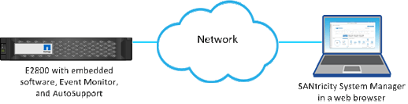

= Découvrez comment accéder à SANtricity System Manager depuis Unified Manager
:allow-uri-read: 
:icons: font
:imagesdir: ../media/

[role="lead"]
Vous sélectionnez une ou plusieurs baies de stockage et utilisez l'option Launch pour ouvrir SANtricity System Manager lorsque vous souhaitez configurer et gérer des baies de stockage.

System Manager est une application embarquée sur les contrôleurs, connectée au réseau via un port de gestion Ethernet. Elle inclut toutes les fonctions basées sur la baie.

Pour accéder à System Manager, vous devez disposer de :

* L'un des modèles de tableaux répertoriés ici : link:https://docs.netapp.com/us-en/e-series/getting-started/learn-hardware-concept.html["Présentation du matériel E-Series"^]
* Une connexion hors bande à un client de gestion de réseau avec un navigateur web.

